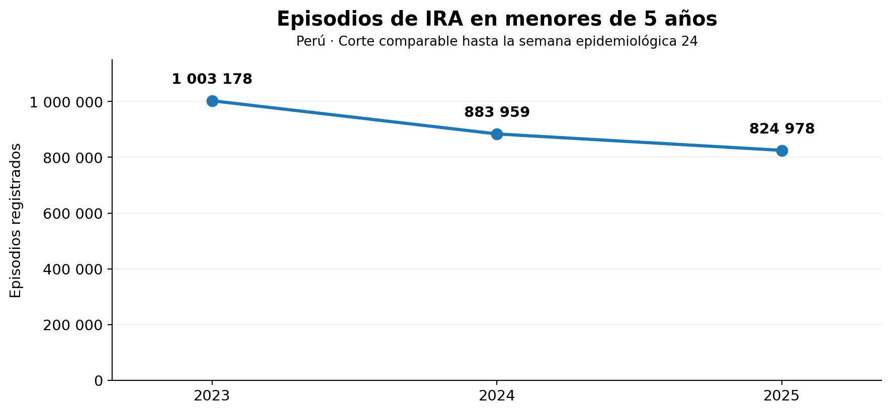
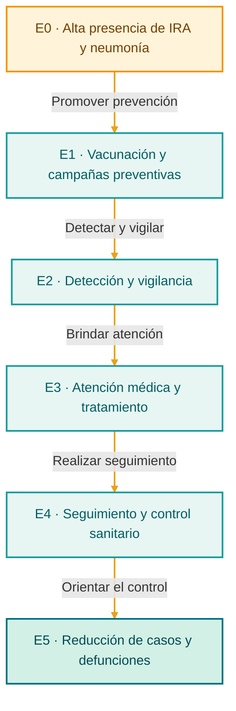
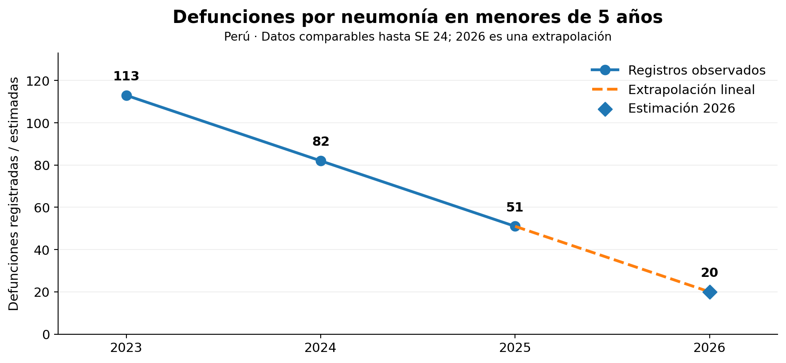
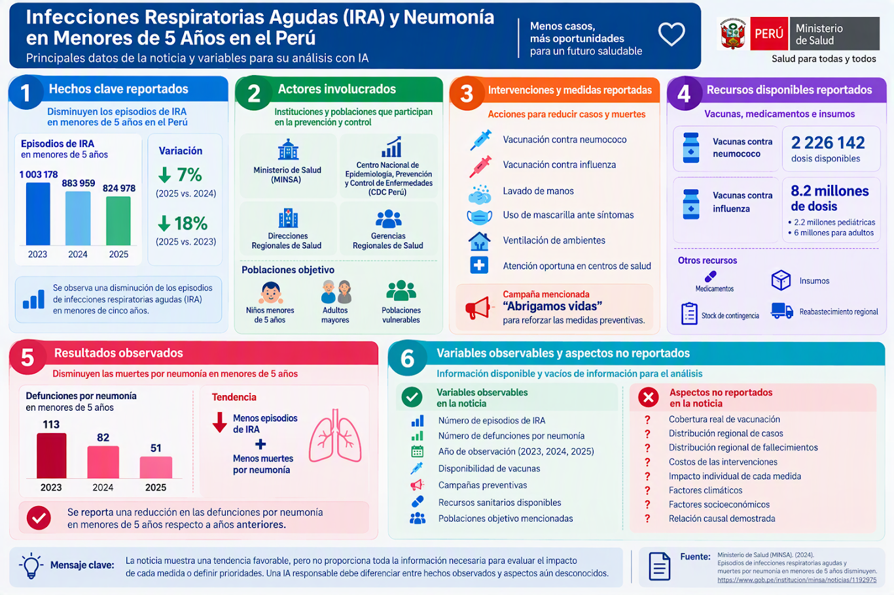

  

### Infecciones Respiratorias Agudas (IRA) y neumonía en menores de 5 años en el Perú

Salud pública · Representación de estados · Búsqueda y predicción

  

 

Curso: Machine Learning &nbsp;·&nbsp; Python &nbsp;·&nbsp; Google Colab &nbsp;·&nbsp; GitHub

  

## 1. Contexto del caso

Las **infecciones respiratorias agudas (IRA)** afectan las vías respiratorias; la **neumonía** es una infección de los pulmones que puede ser grave en niños pequeños (Organización Mundial de la Salud, 2022). En el Perú, el **Ministerio de Salud (MINSA)** reportó una disminución de episodios de IRA y defunciones por neumonía en menores de cinco años (MINSA, 2025b).

> **Periodo de análisis:** los registros corresponden a periodos comparables hasta la **semana epidemiológica 24 (SE 24)**, es decir, la semana número 24 utilizada para vigilar enfermedades. En 2025, el corte fue el **15 de junio**. **No son cifras de años completos.**

### Indicadores principales

| **824 978** | **51** | **−18 %** |
|:--:|:--:|:--:|
| Episodios de IRA en 2025 | Defunciones por neumonía en 2025 | Episodios de IRA en 2025 frente a 2023 |

| Indicador · menores de 5 años | 2023 | 2024 | 2025 |
|:--|--:|--:|--:|
| Episodios de IRA | 1 003 178 | 883 959 | **824 978** |
| Defunciones por neumonía | 113 | 82 | **51** |

  

Figura 1. Episodios de IRA hasta la semana epidemiológica 24 (SE 24) de cada año. Elaboración propia con datos del MINSA (2025b).

**Acciones reportadas en la infografía:** vacunación contra neumococo e influenza, lavado de manos, mascarilla ante síntomas, ventilación, atención oportuna y campaña «Abriguemos vidas». Se mencionan **2 226 142 dosis** contra neumococo —disponibilidad también documentada por el MINSA (2025a)— y **8,2 millones de dosis** contra influenza. La vacunación es una medida preventiva relevante (MINSA, 2025c), pero **dosis disponibles no equivale a cobertura real de vacunación**.

  

## 2. Problema, justificación y objetivos

**Problema:** aunque los indicadores disminuyeron, las IRA y la neumonía siguen afectando a la población infantil. Se necesita organizar las acciones sanitarias y analizar la tendencia observada sin atribuir efectos que los datos no demuestran.

**Pregunta central:** ¿cómo utilizar la **Inteligencia Artificial (IA)** para representar una ruta de intervención y el **aprendizaje automático (Machine Learning)** para estimar la tendencia de las defunciones por neumonía?

**Objetivo general:** construir dos *pipelines* (secuencias ordenadas de pasos): uno de **razonamiento y búsqueda** y otro de **predicción y visualización**.

| Enfoque | ¿Por qué se utiliza? |
|:--|:--|
| **IA: búsqueda** | Representa situaciones, acciones y restricciones; permite encontrar una ruta desde el problema hasta el objetivo. |
| **Machine Learning: regresión** | Ajusta un modelo a datos históricos y muestra una tendencia numérica mediante una gráfica. |

  

## 3. Metodología

### 3.1. Espacio de estados

Un **estado** describe una situación del problema; el **espacio de estados** reúne las situaciones consideradas y las conexiones entre ellas.

| Estado | Situación | Tipo |
|:--:|:--|:--|
| **E0** | Alta presencia de IRA y neumonía | **Inicial** |
| E1 | Vacunación y campañas preventivas | Intermedio |
| E2 | Detección y vigilancia | Intermedio |
| E3 | Atención médica y tratamiento | Intermedio |
| E4 | Seguimiento y control sanitario | Intermedio |
| **E5** | Reducción de casos y defunciones | **Objetivo** |

Las flechas del diagrama son **transiciones** y sus etiquetas indican los **operadores**, es decir, las acciones que conectan los estados.

**Restricciones:** no se dispone de cobertura real de vacunación, datos por región, costos, factores climáticos o socioeconómicos ni pruebas del efecto individual de las intervenciones. El diagrama es **conceptual**: las acciones pueden ocurrir simultáneamente y no garantizan alcanzar E5.

### 3.2. Pipeline de razonamiento y búsqueda

Se aplica **BFS (Breadth-First Search o búsqueda en amplitud)**, algoritmo que explora primero los estados más cercanos al inicial. Utiliza una cola **FIFO** («primero en entrar, primero en salir»).

| Etapa | Aplicación |
|:--|:--|
| **Problema** | Ir de E0 (situación inicial) a E5 (objetivo). |
| **Estados** | Representar E0, E1, E2, E3, E4 y E5. |
| **Exploración** | Revisar las conexiones y registrar estados visitados. |
| **Búsqueda** | Ejecutar BFS hasta encontrar E5. |

<strong>E0 → E1 → E2 → E3 → E4 → E5</strong>

Como existe **una sola ruta**, BFS muestra el recorrido, pero **no compara alternativas ni identifica la intervención sanitaria más eficaz**.

### 3.3. Pipeline de predicción y visualización

Se emplea **regresión lineal**, un modelo de aprendizaje supervisado que utiliza ejemplos conocidos para ajustar una recta y estimar un valor numérico. Se eligió por su sencillez e interpretación visual.

| Etapa | Aplicación |
|:--|:--|
| **Datos** | Años 2023, 2024 y 2025; defunciones **113, 82 y 51**. |
| **Entrada (`X`)** | Año de observación. |
| **Salida (`y`)** | Defunciones por neumonía hasta la SE 24. |
| **Modelo** | `LinearRegression` de Scikit-learn. |
| **Estimación** | Periodo equivalente de 2026. |
| **Visualización** | Datos observados y extrapolación en una gráfica. |

<strong>Datos históricos → Entrenamiento → Regresión lineal → Estimación 2026 → Gráfica</strong>

La disminución es de **31 defunciones por año** en estos tres registros. Al prolongar esa recta (*extrapolación*, es decir, estimación fuera de los años observados), el modelo calcula **20 defunciones para el periodo equivalente de 2026**.

  

Figura 2. Defunciones observadas en 2023–2025 y extrapolación ilustrativa a 2026, para periodos equivalentes hasta la SE 24. Elaboración propia.

> **Importante:** **20 no es un dato real ni un pronóstico validado.** Solo se usaron tres observaciones, sin datos independientes para comprobar la precisión del modelo. Tampoco se incluyeron variables como clima, vacunación o distribución regional.

  

## 4. Resultados y discusión

  
| Componente | Resultado obtenido | Interpretación |
|:--|:--|:--|
| **Búsqueda BFS** | E0 → E1 → E2 → E3 → E4 → E5 | Ruta conceptual única. |
| **IRA** | 1 003 178 → 824 978 | Disminución observada entre 2023 y 2025. |
| **Defunciones** | 113 → 82 → 51 | Tendencia histórica descendente. |
| **Regresión lineal** | **20** para 2026 | Extrapolación ilustrativa, no cifra confirmada. |

La reducción de los indicadores es relevante para la salud pública, pero **no demuestra una relación causal** con las medidas preventivas. Para evaluar su impacto o construir predicciones más confiables se necesitarían más años de datos y variables epidemiológicas adicionales.

  

## 5. Conclusiones

1. **IA:** el espacio de estados y BFS permiten explicar una secuencia de acciones de prevención, vigilancia, atención y seguimiento, aunque el modelo no compara estrategias alternativas.
2. **Machine Learning:** la regresión lineal representa la disminución histórica de defunciones y produce una estimación matemática fácil de visualizar.
3. **Salud pública:** los datos muestran una tendencia favorable, pero la proyección de 2026 debe interpretarse con cautela y no permite afirmar que las intervenciones causaron la reducción.

  

## 6. Implementación

**[Consultar el notebook del Challenge 2](Challenge2.ipynb)** — desarrollado a partir del notebook del examen parcial, con los dos pipelines en Python.

**[Consultar el notebook del examen parcial](Parcial_MachineLearning.ipynb)** — Código desarrollado durante el Examen Parcial del curso.

 

| Herramienta | Uso |
|:--|:--|
| **Google Colab y Python** | Ejecución del notebook y procesamiento de datos. |
| **`collections.deque`** | Cola utilizada por BFS. |
| **NumPy y Scikit-learn** | Preparación de datos y regresión lineal. |
| **Matplotlib** | Elaboración de las gráficas. |
| **GitHub** | Presentación y documentación del trabajo. |

  

## 7. Fuentes de información

### Infografía del caso

  

Figura 3. Infografía del examen parcial · <a href="https://www.gob.pe/institucion/minsa/noticias/1192975">Fuente de los datos: MINSA</a>.

### Referencias bibliográficas

Ministerio de Salud del Perú. (2025a, 19 de mayo). *Bajas temperaturas: Minsa refuerza protección contra la neumonía con más de 2 millones de vacunas a nivel nacional*. https://www.gob.pe/institucion/minsa/noticias/1170855-bajas-temperaturas-minsa-refuerza-proteccion-contra-la-neumonia-con-mas-de-2-millones-de-vacunas-a-nivel-nacional

Ministerio de Salud del Perú. (2025b, 23 de junio). *Episodios de infecciones respiratorias agudas y muertes por neumonía en menores de 5 años disminuyen*. https://www.gob.pe/institucion/minsa/noticias/1192975

Ministerio de Salud del Perú. (2025c, 8 de agosto). *Minsa recuerda la importancia de la vacunación para prevenir la neumonía, influenza y covid-19 en temporada de invierno*. https://www.gob.pe/institucion/minsa/noticias/1223170-minsa-recuerda-la-importancia-de-la-vacunacion-para-prevenir-la-neumonia-influenza-y-covid-19-en-temporada-de-invierno

Organización Mundial de la Salud. (2022, 11 de noviembre). *Neumonía infantil*. https://www.who.int/es/news-room/fact-sheets/detail/pneumonia

  

<strong>Nota de edición:</strong> ChatGPT (OpenAI) brindó apoyo en la corrección ortográfica, la mejora de la redacción y la presentación visual de este README. Los datos del caso proceden de la infografía y de las fuentes citadas.

Análisis de IRA y neumonía en el Perú · Machine Learning

  

